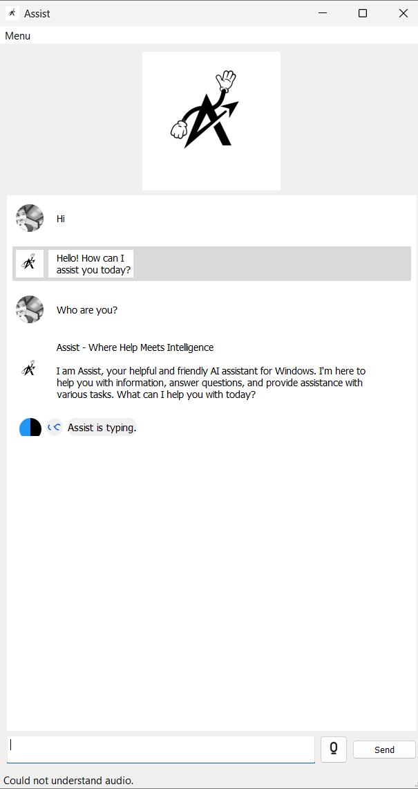
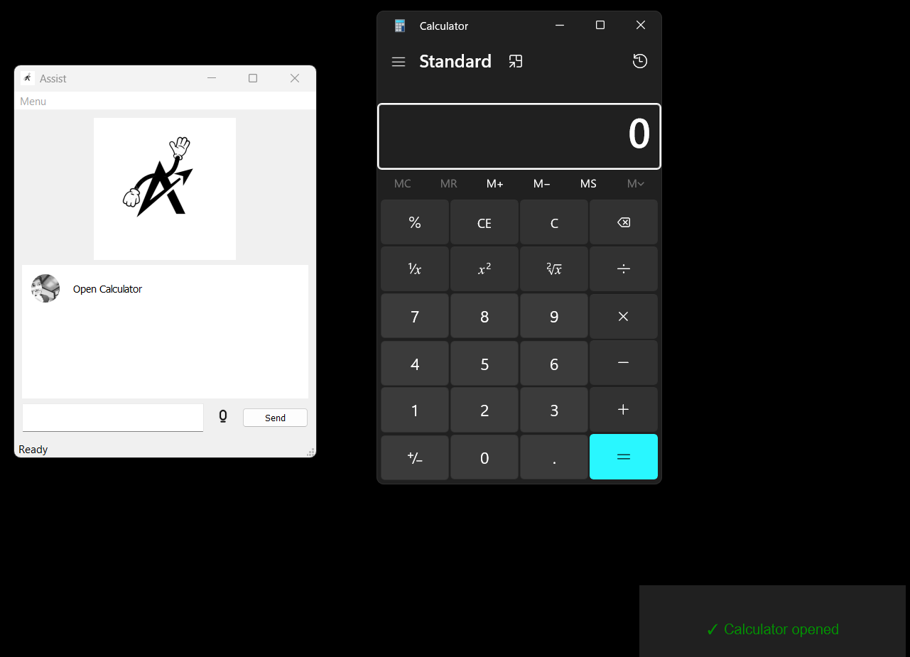
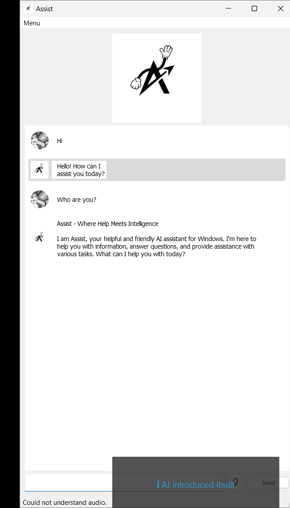
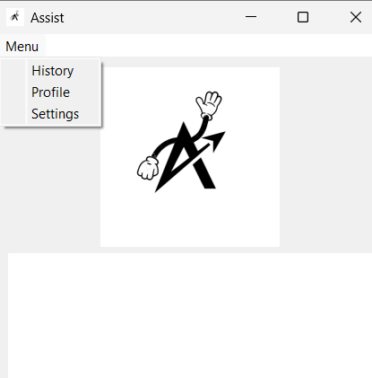
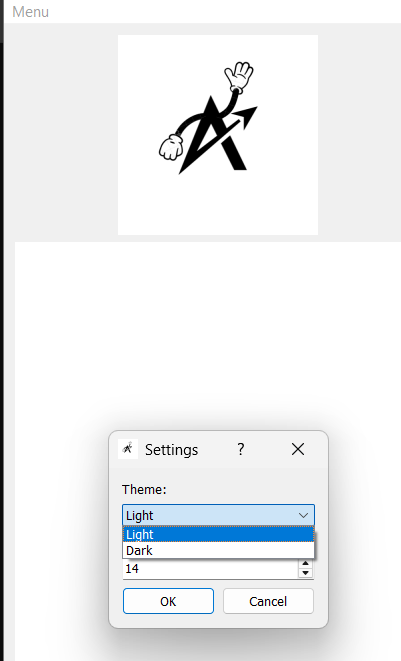
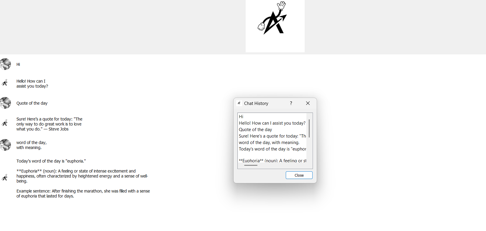
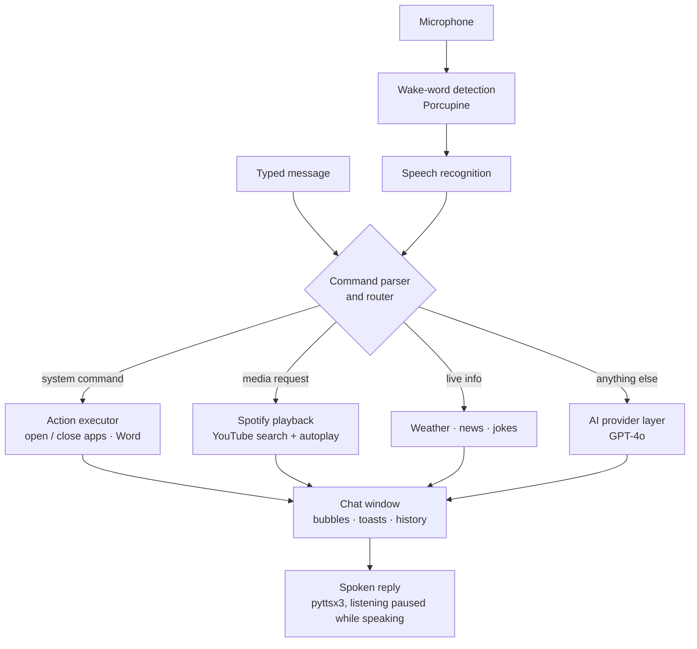

# Assist: AI Desktop Assistant

A voice-activated AI assistant for Windows. Say the wake word, speak a request, and Assist either answers with GPT-4o or acts on your PC: opening apps, playing music and videos, fetching weather and news, or typing into Word.

> **Note:** The source code is private. This repository documents the features and design. I'm happy to walk through the implementation in an interview.

**Built:** May–June 2025.

---

## Overview

Everyday computer tasks still mean clicking through menus: opening an app, finding a song, checking the weather, starting a document. Assist puts these behind a single wake word. A spoken or typed request is first matched against known commands, which run instantly on the PC; anything else goes to GPT-4o, and the answer appears in a chat window and is read aloud.

## Key Features

- **Hands-free activation:** a Porcupine wake-word detector starts listening, speech recognition turns the request into text, and replies are spoken with on-device text-to-speech. Typed messages work too.
- **AI conversation:** open questions go to GPT-4o through the OpenAI API, behind a provider layer that keeps the model swappable.
- **Desktop actions:** open and close applications by voice (for example, "open calculator").
- **Media:** play a requested song on Spotify, or find a YouTube video with the YouTube Data API and start it automatically.
- **Live information:** the time, current weather, the latest news headlines and a joke on request.
- **Office automation:** on command, Assist opens Microsoft Word and types into a new document through COM automation.
- **Polished desktop UI:** chat bubbles with a typing indicator, toast notifications, chat history, a profile page and settings for light or dark theme and font size, packaged as a standalone Windows app.

## Screenshots

| | |
|---|---|
|  |  |
| *"Open calculator": a desktop action with a confirmation toast* | *An AI reply, spoken and shown in the chat* |
|  |  |
| *Menu: history, profile and settings* | *Theme and font-size settings* |

*Chat history panel*

## Architecture

## How It Works

1. The wake-word detector listens in the background; once triggered, speech recognition captures the request.
2. A command parser checks whether the request is a known action, such as opening an app, playing media or fetching live information.
3. Known actions run directly: apps launch through the operating system, songs play through the Spotify Web API and videos open from a YouTube search.
4. Everything else is sent to GPT-4o with an assistant persona.
5. The response appears in the chat window and is read aloud. Listening pauses while Assist speaks, so it doesn't hear itself.

## Tech Stack

| Category | Tools |
|---|---|
| Language | Python |
| Desktop UI | PyQt (chat window, dialogs, themes, animations) |
| Voice | Porcupine wake word, SpeechRecognition, PyAudio, pyttsx3 |
| AI | OpenAI API (GPT-4o) behind a pluggable provider layer |
| Integrations | Spotify Web API (spotipy, OAuth token refresh), YouTube Data API, Open-Meteo weather, GNews headlines, Microsoft Word automation |
| Packaging | PyInstaller (standalone Windows executable) |

## Engineering Decisions

- **Commands before the LLM:** recognised commands run immediately without an API call, which is faster and cheaper; only open-ended requests go to the model.
- **Swappable AI provider:** the assistant talks to a provider interface rather than to one SDK, so the model can change without touching the UI.
- **Don't listen to yourself:** speech recognition pauses while the assistant is speaking and resumes when it finishes.
- **Long-lived Spotify access:** the Spotify integration refreshes its OAuth token automatically, so playback keeps working without signing in again.

## My Role

I designed and built Assist on my own: the voice pipeline, the command parser and router, the AI provider layer, the integrations and the PyQt desktop interface.

## Contact

**Zayed Makandar** | [zayedmakandar03@gmail.com](mailto:zayedmakandar03@gmail.com) | [LinkedIn](https://www.linkedin.com/in/zayed-makandar-642536422/) | [Portfolio](https://zayedmakandar.com)
